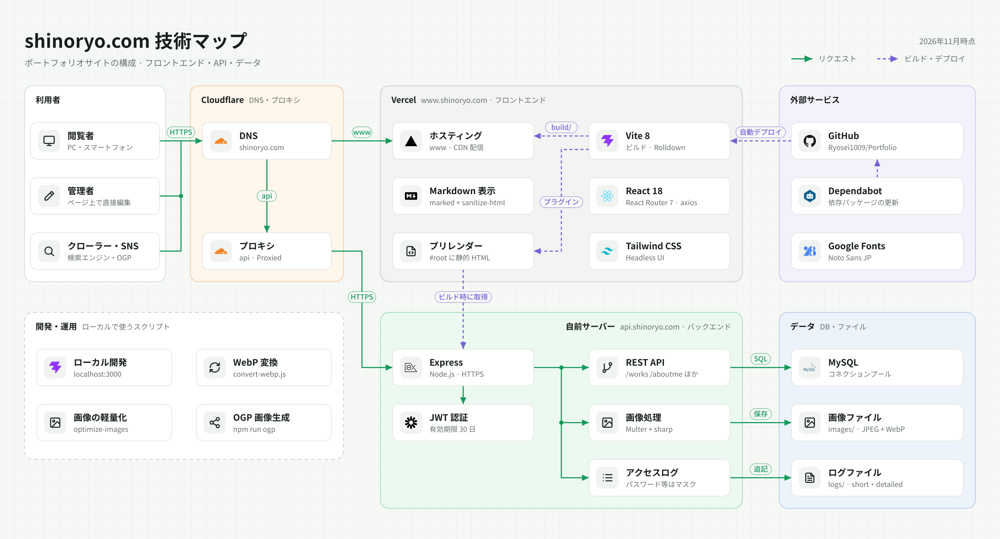

<div align="center">


# Ryosei Shinohara's Portfolio Website

**▶ [www.shinoryo.com](https://www.shinoryo.com)**

</div>

これまでの制作物と自己紹介をまとめたポートフォリオサイトです。
フロントエンドとバックエンドの両方を自分で設計・実装し、自分でサーバーを運用しています。

## 見どころ

- **About Me**: プロフィール、経歴、スキル、連絡先
- **Works**: 制作物ごとに「目的」「工夫」「展望」をまとめ、画像ギャラリーや動画でも紹介しています

## こだわったところ

### サイト上で直接編集できる

コンテンツはソースコードに直接書かず、データベースで管理しています。
管理者としてログインすると、ページ上の編集ボタンからプロフィールや作品情報を書き換えられます。
作品を追加・更新するたびにコードを変更してデプロイし直す必要はありません。

- パスワード認証で JWT を発行し、編集用 API はトークンを検証してから処理します
- About Me の文章は Markdown で書けて、`sanitize-html` でサニタイズしてから表示します

### どの画面サイズでも見やすく

Tailwind CSS のブレークポイントを細かく指定して、スマートフォンからワイドディスプレイまでレイアウトを調整しています。
作品画像はサムネイル・中サイズ・原寸を使い分け、遅延読み込みで表示を軽くしています。

### メンテナンスを続けている

公開して終わりではなく、依存パッケージを更新し続けています。
Dependabot のアラートに対応するため、Create React App から Vite へ移行しました。

## 技術スタック


|              |                                                         |
| ------------ | ------------------------------------------------------- |
| **Frontend** | React 18, React Router, Vite, Tailwind CSS, Headless UI |
| **Backend**  | Node.js, Express, JWT, Multer                           |
| **Database** | MySQL                                                   |
| **Infra**    | Vercel, Cloudflare (DNS・プロキシ), HTTPS, 独自ドメイン (`shinoryo.com`) |

### 構成図

<picture>
  <source media="(prefers-color-scheme: dark)" srcset="docs/tech-map-dark.png">
  
</picture>

## ディレクトリ構成

```
.
├── frontend/   # React アプリ（表示・編集 UI）
├── backend/    # Express API サーバー（データ取得・更新、認証、画像配信）
└── docs/       # README 用の画像（構成図）
```

## Contact

- GitHub: [@Ryosei1009](https://github.com/Ryosei1009)
- Mail: shinoryo1009@gmail.com
